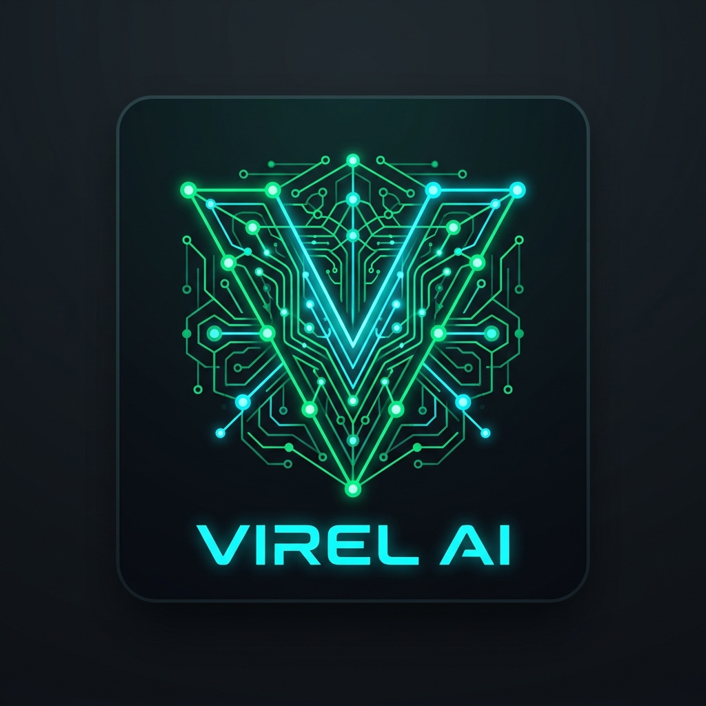
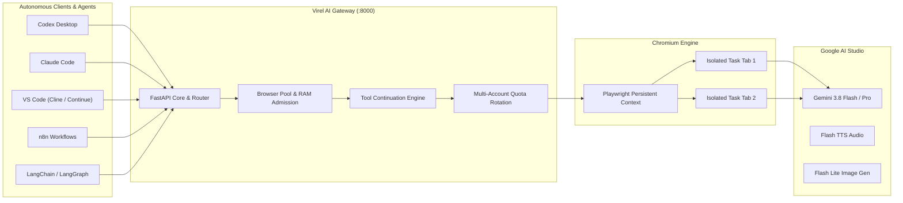
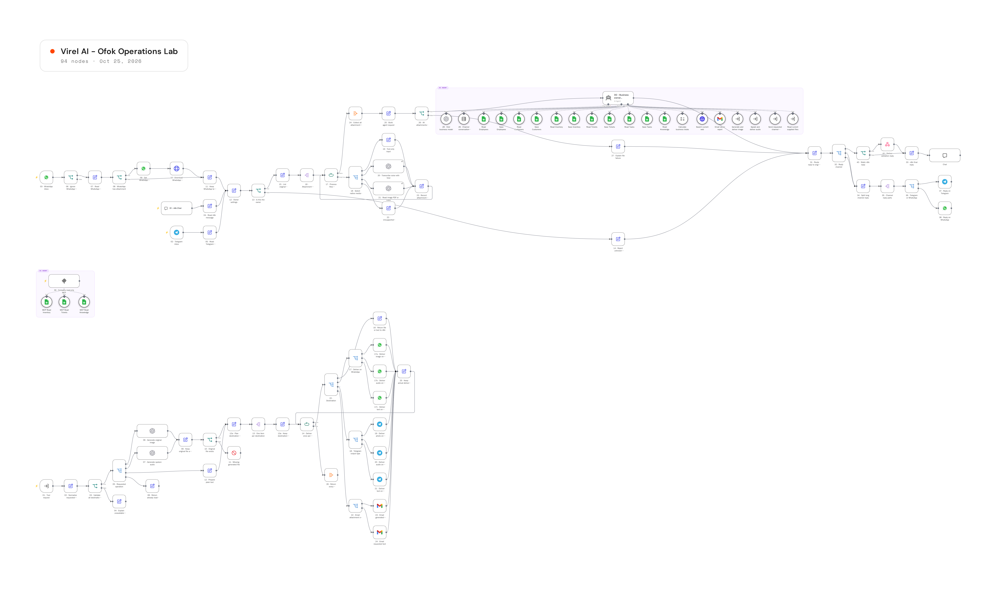

<div align="center">

<a href="https://github.com/ABo-EsMaiL/Virel-AI">
  
</a>

# Virel AI

### High-Performance Local AI Studio Gateway for Autonomous Coding Agents

<p align="center">
  <a href="https://readme-typing-svg.demolab.com">
    
  </a>
</p>

<p align="center">
  
  
  
  
  
  
  
  
  
  
</p>

---

</div>

## Overview

**Virel AI** is a local gateway that connects modern autonomous coding agents to **Google AI Studio**. Instead of paying prohibitive per-token API costs or running into strict free-tier rate limits, Virel AI exposes standard HTTP interfaces (**OpenAI Chat Completions**, **OpenAI Responses API**, and **Anthropic Messages API**) driven by an automated, persistent Chromium session in Google AI Studio.

Your developer tools and orchestration workflows connect to Virel AI as if it were an official API provider. Under the hood, Virel AI handles DOM automation, native tool continuation loops, streaming response emulation, multimodal file uploads, and transparent Google account rotation when daily request limits are met.

---

## Architectural Highlights



### Key Technical Pillars

- **Full Protocol Parity**: Native compatibility with `/v1/chat/completions`, `/v1/responses`, `/v1/messages`, and `/claude/v1/messages`.
- **Client-Owned Tool Continuation**: Clients execute their own tools locally. Virel AI retains the exact browser chat turn until the entire multi-turn tool cycle concludes.
- **Cryptographic Multi-Tenant Tab Isolation**: Every incoming request receives its own dedicated browser page. Different clients operating concurrently (such as Codex, Hermes, and n8n) are strictly partitioned by authorization hashes.
- **Multi-Account Quota Rotation**: Automatically shifts to the next configured Google account (`authuser=0`, `authuser=1`, etc.) upon detecting rate limits (HTTP 429) or daily quotas, tracking cooldown periods automatically.
- **Multimodal Processing**: Native ingestion of text, source code, large PDFs, audio, video, and images, along with native image generation and speech synthesis (TTS).

---

## Enterprise Showcase: The Ofok Operations Lab

A production-grade, 58-node autonomous multi-agent business workflow built natively in **n8n**, powered by **Gemini 3.8 Flash** via Virel AI.

<div align="center">

[](assets/n8n_workflow.png)

<p align="center">
  <a href="assets/n8n_workflow.png"><b>View Full-Resolution Diagram</b></a> &nbsp;|&nbsp; 
  <a href="examples/n8n_ofok_operations_lab.json"><b>Download Workflow JSON</b></a>
</p>

</div>

### Verified Operations Matrix

| Operations Domain | Integrated Nodes | Execution Nature |
|---|---|---|
| **Central Intelligence** | OpenAI Chat Model (`:8000/v1`) | Gemini 3.8 Flash with high reasoning effort |
| **Omnichannel Ingestion**| Telegram, WhatsApp, n8n Chat | Customer service and executive reporting channels |
| **Sequential Multimodal**| Voice Transcribe, Vision, PDF Extractor | Preprocessing incoming multimedia before agent reasoning |
| **Enterprise Database** | Google Sheets ERP (6 Tabs) | Read/Save for Employees, Customers, Inventory, Tickets, Tasks, Knowledge |
| **Business Execution** | SearchApi, Gmail API, Calculator | Real-time market research, financial math, executive report dispatch |
| **Developer Extensibility**| Model Context Protocol (MCP) | Read-only MCP server exposing ERP knowledge to IDE agents |

---

## Quick Start

### Prerequisites

- Python 3.12 or higher
- Google Chrome or Chromium installed
- A Google account with access to [Google AI Studio](https://aistudio.google.com/)

---

### Step 1: Clone and Setup Environment

```powershell
# Clone the repository
git clone https://github.com/ABo-EsMaiL/Virel-AI.git
cd Virel-AI

# Create and activate virtual environment
python -m venv .venv
./.venv/Scripts/Activate.ps1

# Install dependencies and Playwright browser
pip install -r requirements.txt
playwright install chromium
```

---

### Step 2: Generate API Key and Configure `.env`

Generate a secure random 32-byte hexadecimal key for your local gateway:

**Using OpenSSL:**
```powershell
openssl rand -hex 32
```

**Or using Python:**
```powershell
python -c "import secrets; print(secrets.token_hex(32))"
```

Copy the example configuration:
```powershell
Copy-Item .env.example .env
```

Open `.env` and configure your parameters:

```ini
# ==============================================================================
# Virel AI Gateway - Environment Configuration
# ==============================================================================

# Master API Key required in client requests (Authorization: Bearer <key>)
VIREL_API_KEY=your-generated-hex-key-here

# Persistent browser profile folder (where Google account login is stored)
CHROME_PROFILE_DIR=./chrome_profile

# Server Port (default 8000)
PORT=8000

# Browser visibility (false = visible window for inspection, true = headless)
HEADLESS=false

# Default model used when no explicit model is specified
DEFAULT_MODEL=gemini-flash-latest

# Default thinking level for reasoning models (high, low, or minimal)
THINKING_MODE=high

# Multi-Account Quota Rotation (Google authuser indices: 0, 1, 2...)
VIREL_GOOGLE_ACCOUNTS_COUNT=2
VIREL_ACCOUNT_COOLDOWN_HOURS=6

# Concurrency & Memory Management
VIREL_MAX_CONCURRENT=20
VIREL_MAX_QUEUE=100
VIREL_QUEUE_TIMEOUT_SECONDS=120
VIREL_MEMORY_RESERVE_MB=1024
VIREL_TAB_MEMORY_MB=512
VIREL_MAX_WAITING_TABS=20

# Active Tool Continuation Lease Timeout (seconds)
VIREL_TOOL_RUN_TTL_SECONDS=600

# Rate limiting per IP (slowapi)
VIREL_RATE_LIMIT=30/minute

# Built-in Google AI Studio tools for ordinary prompts
ENABLE_URL_CONTEXT=true
ENABLE_SEARCH_GROUNDING=false

# Media and Request Payload Bounds
VIREL_MAX_REQUEST_MB=128
VIREL_MAX_PDF_MB=50
VIREL_MAX_PDF_PAGES=1000
VIREL_MAX_AUDIO_MB=25
VIREL_MAX_VIDEO_MB=50
VIREL_MAX_GENERATED_IMAGE_MB=20
VIREL_MAX_GENERATED_AUDIO_MB=50
```

---

### Step 3: Google Account Authentication

To authenticate your Google account in the persistent profile:

```powershell
python get_session.py
```

1. A Chromium browser window will open.
2. Sign in with your Google account.
3. Navigate to [Google AI Studio](https://aistudio.google.com/), accept any initial onboarding modals.
4. If configuring multiple accounts (`authuser=0`, `authuser=1`), switch to each account in Google AI Studio to initialize them.
5. Close the browser window once done.

---

### Step 4: Launch the Gateway

```powershell
python app.py
```

The gateway is now running at `http://127.0.0.1:8000`.

---

### Alternative: Docker Deployment

To run Virel AI inside a container:

```bash
# Build the Docker image
docker build -t virel-ai .

# Run container mapping port 8000 and the browser profile volume
docker run -d \
  -p 8000:8000 \
  -v ./chrome_profile:/app/runtime/browser-profile \
  --name virel-gateway \
  virel-ai
```

---

## Client Configurations

### Codex Desktop

Configure Virel AI as a custom provider in your Codex configuration file (`config.toml`):

```toml
model = "gemini-flash-latest"
model_provider = "virel"
model_reasoning_effort = "high"

[model_providers.virel]
name = "Virel AI"
base_url = "http://localhost:8000/v1"
env_key = "VIREL_API_KEY"
wire_api = "responses"
requires_openai_auth = false
request_max_retries = 0
stream_max_retries = 0
stream_idle_timeout_ms = 1200000
```

---

### Claude Desktop & Claude Code CLI

#### Claude Desktop (Third-Party Gateway)
In your `claude_desktop_config.json`, configure the gateway URL pointing to the `/claude` base:

```json
{
  "gateway": {
    "url": "http://localhost:8000/claude",
    "api_key": "your-generated-hex-key-here"
  }
}
```

#### Claude Code CLI
Point Claude Code to the dedicated `/claude` endpoint:

```powershell
$env:ANTHROPIC_BASE_URL = "http://localhost:8000/claude"
$env:ANTHROPIC_API_KEY = "your-generated-hex-key-here"

claude --model gemini-flash-latest
```

---

### OpenCode

In your `opencode.json` configuration:

```json
{
  "api_endpoint": "http://localhost:8000/v1",
  "api_key": "your-generated-hex-key-here",
  "model": "gemini-flash-latest",
  "temperature": 0.2
}
```

---

### VS Code (Cline & Continue)

In your VS Code extension settings:
- **Provider**: OpenAI Compatible
- **Base URL**: `http://localhost:8000/v1`
- **API Key**: `your-generated-hex-key-here`
- **Model ID**: `gemini-flash-latest`

---

### n8n Automation Workflows

When adding an OpenAI credential in n8n:
- **Credential**: OpenAI API
- **API Key**: `your-generated-hex-key-here`
- **Base URL**: `http://host.docker.internal:8000/v1` (if n8n runs in Docker) or `http://127.0.0.1:8000/v1`
- **Supported Nodes**:
  - `Chat Model (OpenAI)` -> For AI Agents and conversational agents.
  - `Message a Model` -> For both Chat Completions and modern Responses API.
  - `Generate an Image` & `Edit an Image` -> Native binary output via `gemini-3.1-flash-lite-image`.
  - `Transcribe an Audio` -> Native audio transcription.

---

### LangChain & LangGraph (Python)

```python
from langchain_openai import ChatOpenAI

model = ChatOpenAI(
    model="gemini-flash-latest",
    base_url="http://localhost:8000/v1",
    api_key="your-generated-hex-key-here",
    streaming=True,
    max_retries=0,
)

for chunk in model.stream("Analyze this codebase architecture."):
    print(chunk.text, end="", flush=True)
```

---

## API Reference & Supported Endpoints

| Protocol | Route | Method | Description |
|---|---|---|---|
| **OpenAI Chat** | `/v1/chat/completions` | `POST` | Standard Chat Completions with JSON or SSE streaming |
| **OpenAI Responses** | `/v1/responses` | `POST` | Modern Responses API with structured output items |
| **Anthropic Messages** | `/v1/messages` | `POST` | Anthropic Messages endpoint for Claude Code |
| **Claude Desktop** | `/claude/v1/messages` | `POST` | Third-party desktop client endpoint with Claude model aliases |
| **Image Generation** | `/v1/images/generations` | `POST` | Text-to-image synthesis using AI Studio image models |
| **Image Editing** | `/v1/images/edits` | `POST` | Image-to-image variations and modifications |
| **Audio Speech** | `/v1/audio/speech` | `POST` | Text-to-speech generation (TTS) with selectable voices |
| **Model Catalog** | `/v1/models` | `GET` | Live catalog of observed models in AI Studio |
| **System Health** | `/health` | `GET` | Server readiness, active account, and concurrency state |

---

## License

Virel AI is licensed under the [Apache License 2.0](LICENSE).  
Copyright 2026 Ahmed AbdElHady Esmail; see [NOTICE](NOTICE).
