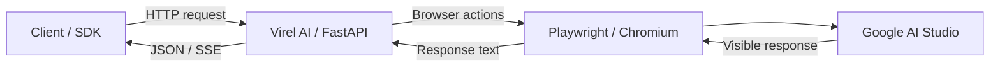

# Virel AI

[](https://github.com/ABo-EsMaiL/Virel-AI/actions/workflows/checks.yml)
[](LICENSE)

**بوابة HTTP لتنفيذ طلبات الذكاء الاصطناعي من خلال المتصفح.**

Virel AI يستقبل طلبًا من برنامجك، يرسل محتواه إلى واجهة Google AI Studio باستخدام Chromium، ثم يعيد الرد في صيغة يستطيع البرنامج قراءتها. الاتصال بالموديل يتم من خلال واجهة الموقع؛ مفتاح البوابة محلي، وليس مفتاح Gemini API.

الاسم مشتق من **Visual Interface Relay**. المشروع يبدأ بـAI Studio، مع فصل بروتوكولات العملاء عن التحكم في المتصفح لتطوير كل جزء تدريجيًا.

## كيف يعمل؟



البوابة تتحقق من الطلب، تجهّز النص والصور، وتستخدم تبويبًا واحدًا لتنفيذ الطلب. أثناء التوليد تقرأ النص من الصفحة؛ ترجع JSON كاملًا، أو أحداث SSE عندما يطلب العميل streaming. المتصفح يحتفظ بتسجيل دخول Google في بروفايل محلي.

## حالة المشروع

**نسخة تأسيس قيد التطوير.** الهيكل مستقل، والاختبارات المحلية واختبارات GitHub Actions متاحة. توافق العملاء وقدرات الوسائط تُثبت باختبارات حية لكل مرحلة.

| القدرة | الحالة الحالية |
|---|---|
| طلب نص وإرجاع JSON | منفذ؛ عقد HTTP مختبر بردود محاكاة |
| SSE في Chat Completions | منفذ؛ تركيب الأحداث مختبر محليًا |
| تجهيز صور في طلبات Chat | منفذ؛ القبول الحي للصورة فقط والصورة مع النص لم يُثبت بعد |
| Responses | adapter جزئي؛ ليس توافقًا كاملًا مع البروتوكول |
| حساب التوكنز والجلسات | مخطط؛ عدّ الكلمات الموروث في Responses ليس عدّ توكنز صحيحًا |
| PDF وصوت وفيديو وأدوات العملاء | مراحل قادمة |
| n8n وLangChain وLangGraph وCodex | أهداف تكامل؛ ليست قائمة عملاء معتمدين حاليًا |

## البداية السريعة

تحتاج **Python 3.12**، وChromium الخاص بـPlaywright، وحسابًا يستطيع استخدام AI Studio. الأوامر التالية لـPowerShell من جذر المشروع:

```powershell
python -m venv .venv
.\.venv\Scripts\Activate.ps1
python -m pip install -r requirements-dev.txt
python -m playwright install chromium
Copy-Item .env.example .env
```

عدّل `.env` قبل التشغيل:

| الإعداد | الغرض |
|---|---|
| `VIREL_API_KEY` | مفتاح خاص ترسله البرامج إلى البوابة |
| `DEFAULT_MODEL` | موديل متاح فعلًا في واجهة حسابك |
| `CHROME_PROFILE_DIR` | مكان بروفايل Google؛ الافتراضي `./runtime/browser-profile` |
| `CLEAR_CHAT_ON_REQUEST` | ابدأ بـ`true` للطلبات المستقلة |

لتجهيز بروفايل جديد وتسجيل الدخول يدويًا:

```powershell
python get_session.py
```

يمكن إعادة استخدام بروفايل موجود بتحديد مساره الكامل في `CHROME_PROFILE_DIR`. اقفل أي نسخة أخرى تستخدم نفس البروفايل قبل تشغيل Virel AI؛ لا يحتاج المشروع نسخ cookies إلى المستودع.

شغّل الخادم محليًا، بعملية وworker واحد:

```powershell
uvicorn app:app --host 127.0.0.1 --port 8001
```

- **Base URL:** `http://localhost:8001/v1`
- **Health:** `http://localhost:8001/health`
- **Authentication:** `Authorization: Bearer <VIREL_API_KEY>`

لو n8n يعمل داخل Docker Desktop والبوابة على نفس الجهاز، استخدم `http://host.docker.internal:8001/v1` بدل localhost، مع تشغيل البوابة على عنوان يمكن للحاوية الوصول إليه. الربط ده جزء من اختبار مرحلة n8n؛ الاستماع المحلي الافتراضي أعلاه لا يتيح الوصول من كل بيئات Docker.

## مثال طلب

ده شكل الطلب على السلك؛ العملاء والـnodes الطبيعية هي اللي ستكوّنه في اختبارات التكامل:

```http
POST /v1/chat/completions HTTP/1.1
Host: localhost:8001
Authorization: Bearer <VIREL_API_KEY>
Content-Type: application/json

{
  "messages": [
    { "role": "user", "content": "اشرح فكرة المشروع في جملة" }
  ],
  "stream": false
}
```

النص يرجع في `choices[0].message.content`. يمكن إرسال `model` لموديل متاح في الواجهة؛ تحديد الاسم في الطلب وحده لا يثبت أن اختيار الموديل في المتصفح نجح. مثال الطلب ليس نتيجة تجربة حية على حساب Google.

## المسارات الحالية

| المسار | الاستخدام |
|---|---|
| `POST /v1/chat/completions` | نص وصور Chat؛ JSON أو SSE |
| `POST /v1/responses` | Responses الجزئي؛ له alias هو `/responses` |
| `POST /v1/completions` | مسار نص قديم للعملاء الذين يحتاجونه |
| `GET /v1/models` | كتالوج موروث ثابت، وليس اكتشافًا لقدرات الحساب |
| `GET /health` | حالة الخادم والمتصفح والإعدادات |

## بنية الكود

```text
app.py                  نقطة التشغيل
get_session.py          إعداد تسجيل دخول Google
virel/
  routes/               بروتوكولات HTTP
  schemas.py            عقود المدخلات
  messages.py           تحويل النص وتجهيز الصور
  browser.py            التحكم في AI Studio
  dom.py                استخراج الرد من الصفحة
  runtime.py            الموارد والتزامن
  config.py / auth.py   الإعدادات والمصادقة
tests/                  اختبارات HTTP وDOM ومسارات التشغيل
docs/                   شرح التصميم والمدخلات والحدود
specs/                  مواصفات كل مرحلة وخطتها وأدلتها
tasks/                  الخطة العامة والمتابعة
runtime/                بيانات تشغيل خاصة، مستبعدة من Git
```

## الاختبارات والتطوير

```powershell
python -m unittest discover -s tests -v
```

فيه **17 اختبارًا**: عقود HTTP بردود محاكاة، وقراءة DOM داخل Chromium معزول، وثبات مسارات البروفايل والجلسة عند تغيير فولدر التشغيل. اختبارات CI لا تستخدم حساب Google أو ترسل prompts حقيقية.

المشروع مهيّأ باستخدام [GitHub Spec Kit](https://github.com/github/spec-kit). كل مرحلة لها مواصفات وbranch واختبارات قبول، مع الحفاظ على اختبارات المراحل السابقة. حساب usage سيشمل الطلب والجلسة ومصدر الأرقام ودقتها؛ لن تُعرض الأرقام التقديرية كأنها قياس رسمي.

## الحدود المعروفة

- التحكم في الموقع يتأثر بتغير الواجهة وتسجيل الدخول وحدود الحساب والموديل.
- تحويل history الحالي غير مكتمل؛ وضع الشات الثابت يستخدم تبويبًا مشتركًا وليس جلسات معزولة.
- أخطاء التوليد وResponses وusage تحتاج استكمالًا قبل اعتمادها لدى العملاء.
- مدخلات الصور ومسارات التشخيص تحتاج تأمينًا إضافيًا قبل إتاحة الخادم خارج البيئة المحلية.
- الملف `.env` والبروفايل والجلسات وuploads بيانات خاصة؛ لا تُرفع إلى Git.

## التوثيق

| الدليل | المحتوى |
|---|---|
| [خريطة المشروع](docs/architecture.md) | مسؤولية كل ملف ورحلة الطلب |
| [الخطة](tasks/plan.md) | مراحل التطوير وحالات قبولها |
| [المدخلات](docs/client-inputs.md) | أشكال الطلبات والملفات والتكامل المستهدف |
| [سياسة usage](docs/usage.md) | عدّ التوكنز للطلبات والجلسات وحدود القياس |
| [تقرير التأسيس](docs/foundation-report.md) | ما نُقل وما حُذف والعيوب الموروثة |
| [قائمة الحذف](docs/cleanup-inventory.md) | سجل التنظيف وأسبابه |
| [المتابعة](tasks/todo.md) | ما أُنجز والخطوة التالية |

## الترخيص

[MIT](LICENSE). نُسب الترخيص الأصلية محفوظة في الملف.
