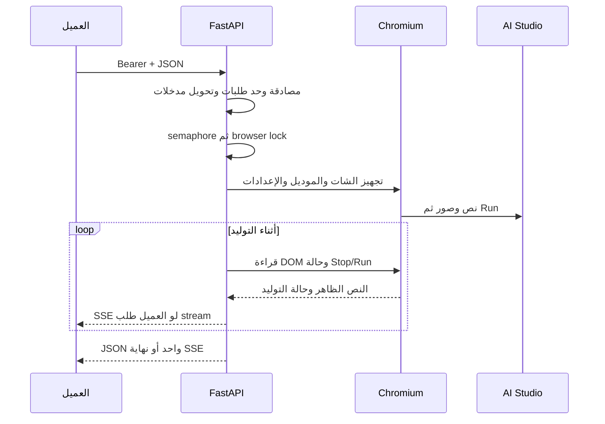

# المشروع فين وبيعمل إيه؟

## خريطة الملفات

| المكان | المسؤولية | تعدّله إمتى؟ |
|---|---|---|
| `app.py` | نقطة التشغيل وتصدير FastAPI app | تغيير طريقة تشغيل الخادم |
| `virel/server.py` | تركيب routes وCORS وlifespan | إعداد الخادم |
| `virel/config.py` | قراءة env ومسارات runtime | إعداد جديد |
| `virel/auth.py` | مقارنة Bearer key | مصادقة |
| `virel/schemas.py` | عقود رسائل Chat | شكل مدخلات Chat |
| `virel/messages.py` | تحويل رسائل لنص وتجهيز صور | history أو مدخلات |
| `virel/routes/chat.py` | Chat Completions JSON وSSE | توافق OpenAI Chat |
| `virel/routes/responses.py` | Responses الحالي، جزئي | توافق Responses |
| `virel/routes/completions.py` | مسار Completions القديم | العميل اللي لسه بيستخدمه |
| `virel/routes/system.py` | health/models/debug/shutdown | تشخيص أو كتالوج |
| `virel/runtime.py` | browser singleton، limiter، semaphore | الموارد والتزامن |
| `virel/browser.py` | فتح AI Studio، إعداد UI، رفع، إرسال، انتظار | التفاعل مع الواجهة |
| `virel/dom.py` | JavaScript قراءة الرد وحالة التوليد | selectors واستخراج الرد |
| `get_session.py` | تجهيز دخول Google يدويًا | إعداد جلسة |
| `tests/test_gateway.py` و`tests/test_paths.py` | عقود HTTP/DOM ومسارات التشغيل | منع تراجع السلوك |
| `runtime/` | profile، session metadata، uploads | بيانات تشغيل محلية؛ مش Git |
| `docs/` | شرح ثابت وشكل الاستخدام | تحديث التوثيق |
| `tasks/` | roadmap ومتابعة عامة | ترتيب المراحل |
| `specs/<feature>/` | spec/plan/tasks/evidence لمرحلة واحدة | قبل وأثناء كل feature |
| `.specify/` و`.agents/skills/` | Spec Kit الرسمي والقواعد | أدوات التخطيط |
| `.github/workflows/checks.yml` | اختبارات آلية | بوابة قبول التغييرات |

ملفات `__init__.py` لازمة لتعريف حزم Python. متعملش فولدر feature فاضي للمستقبل؛ نضيفه لما يبقى عنده كود ومسؤولية فعلية. دلوقتي كل بروتوكول له route، وتعامل الواجهة له مكان منفصل. تقسيم `browser.py` نفسه هيتعمل تدريجيًا لما feature تحتاجه وباختبارات تحافظ على سلوكه.

## رحلة الطلب

1. تشغيل `app.py` يستورد server. الـlifespan في server يفتح persistent Chromium context ببروفايل Google ويحضر الصفحة، وعند الإغلاق يقفل الموارد.
2. route يقبل JSON ويختبر مفتاح gateway. limiter يحد الطلبات؛ semaphore وlock يمنعوا استخدام نفس التبويب للتوليد في نفس اللحظة. الطلب المشغول ممكن يرجع `429`.
3. Chat يحوّل الرسائل والصور في messages. **حاليًا بيتجاهل رسائل assistant وبيشيل أنماط معينة من النص**؛ ده سلوك موروث، مش history صح لعميل agent.
4. browser يجهز شات جديد حسب الإعداد، ويحاول يغيّر الموديل والتفكير والبحث من UI، ويرفع الصور، ويدخل prompt ويضغط Run. تمرير model في HTTP وحده مش إثبات إن التغيير نجح في UI.
5. dom يقرأ نص الرد، يفصل أجزاء التفكير/الأدوات الظاهرة، ويستخدم fallback لو عنصر الرد اتغير. browser يقارن القراءات ويطلع الزيادة كـdelta، ويستنتج النهاية من حالة الصفحة والتوقيتات.
6. Chat يرجع `choices[0].message.content` في JSON، أو `choices[0].delta.content` في SSE. Responses بيرجع `output` و`output_text`، لكن أحداث stream بتاعته لسه مش مطابقة لبروتوكول Responses الرسمي.

**فيه SSE وقراءة تدريجية بالفعل في الكود**؛ اختباراتنا أثبتت تركيب الأحداث محليًا، وما أثبتتش live streaming من حسابك. المرحلة المخصصة هتختبر القراءة أثناء التوليد، فصل العميل، timeout، ونهاية كل بروتوكول.

## إيه اللي بيتخزن؟

`.env`: مفتاحك وإعداداتك. `runtime/browser-profile/`: جلسة Google وبيانات المتصفح. `runtime/session.json`: metadata إعداد الجلسة، وجوده مش دليل إن تسجيل الدخول صالح. `runtime/uploads/`: ملفات مؤقتة؛ التنظيف والحدود لسه محتاجين شغل. Git وDocker context بيستبعدوا البيانات دي.

## كل endpoint له مكانه

المتاح حاليًا: `/v1/chat/completions`، `/v1/responses` و`/responses`، `/v1/completions`، `/v1/models`، `/health`، `/debug/state`، `/debug_dom`، `/shutdown`. راجع routes لمعرفة الطرق والحقول الفعلية.

نضيف adapter لكل **بروتوكول** مختلف، مش route باسم كل برنامج. عملاء OpenAI Chat يشاركوا نفس المسار؛ Responses له adapter مختلف؛ Anthropic يحتاج `/v1/messages` مستقل. تفاصيل UI تفضل وراء طبقة browser. أي ملف جديد يتكتب في spec بسببه واختبارات قبوله.
