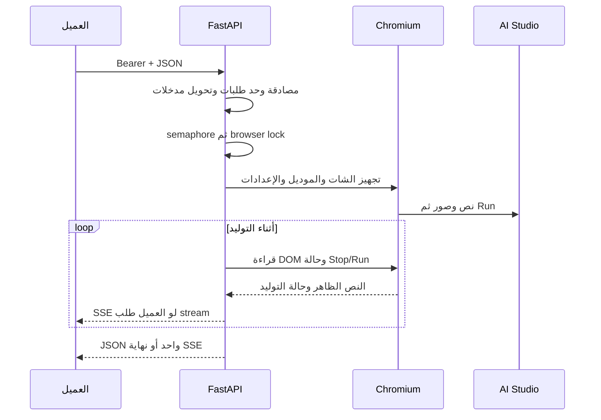

# المشروع فين وبيعمل إيه؟

## خريطة الملفات

| المكان | المسؤولية | تعدّله إمتى؟ |
|---|---|---|
| <code dir="ltr" style="unicode-bidi: isolate;">app.py</code> | نقطة التشغيل وتصدير FastAPI app | تغيير طريقة تشغيل الخادم |
| <code dir="ltr" style="unicode-bidi: isolate;">virel/server.py</code> | تركيب routes وCORS وlifespan | إعداد الخادم |
| <code dir="ltr" style="unicode-bidi: isolate;">virel/config.py</code> | قراءة env ومسارات runtime | إعداد جديد |
| <code dir="ltr" style="unicode-bidi: isolate;">virel/auth.py</code> | مقارنة Bearer key | مصادقة |
| <code dir="ltr" style="unicode-bidi: isolate;">virel/schemas.py</code> | عقود رسائل Chat | شكل مدخلات Chat |
| <code dir="ltr" style="unicode-bidi: isolate;">virel/messages.py</code> | تحويل رسائل لنص وتجهيز صور | history أو مدخلات |
| <code dir="ltr" style="unicode-bidi: isolate;">virel/routes/chat.py</code> | Chat Completions JSON وSSE | توافق OpenAI Chat |
| <code dir="ltr" style="unicode-bidi: isolate;">virel/routes/responses.py</code> | Responses الحالي، جزئي | توافق Responses |
| <code dir="ltr" style="unicode-bidi: isolate;">virel/routes/completions.py</code> | مسار Completions القديم | العميل اللي لسه بيستخدمه |
| <code dir="ltr" style="unicode-bidi: isolate;">virel/routes/system.py</code> | health/models/debug/shutdown | تشخيص أو كتالوج |
| <code dir="ltr" style="unicode-bidi: isolate;">virel/runtime.py</code> | browser singleton، limiter، semaphore | الموارد والتزامن |
| <code dir="ltr" style="unicode-bidi: isolate;">virel/browser.py</code> | فتح AI Studio، إعداد UI، رفع، إرسال، انتظار | التفاعل مع الواجهة |
| <code dir="ltr" style="unicode-bidi: isolate;">virel/dom.py</code> | JavaScript قراءة الرد وحالة التوليد | selectors واستخراج الرد |
| <code dir="ltr" style="unicode-bidi: isolate;">get_session.py</code> | تجهيز دخول Google يدويًا | إعداد جلسة |
| <code dir="ltr" style="unicode-bidi: isolate;">tests/test_gateway.py</code> و<code dir="ltr" style="unicode-bidi: isolate;">tests/test_paths.py</code> | عقود HTTP/DOM ومسارات التشغيل | منع تراجع السلوك |
| <code dir="ltr" style="unicode-bidi: isolate;">runtime/</code> | profile، session metadata، uploads | بيانات تشغيل محلية؛ مش Git |
| <code dir="ltr" style="unicode-bidi: isolate;">docs/</code> | شرح ثابت وشكل الاستخدام | تحديث التوثيق |
| <code dir="ltr" style="unicode-bidi: isolate;">tasks/</code> | roadmap ومتابعة عامة | ترتيب المراحل |
| <code dir="ltr" style="unicode-bidi: isolate;">specs/&lt;feature&gt;/</code> | spec/plan/tasks/evidence لمرحلة واحدة | قبل وأثناء كل feature |
| <code dir="ltr" style="unicode-bidi: isolate;">.specify/</code> و<code dir="ltr" style="unicode-bidi: isolate;">.agents/skills/</code> | Spec Kit الرسمي والقواعد | أدوات التخطيط |
| <code dir="ltr" style="unicode-bidi: isolate;">.github/workflows/checks.yml</code> | اختبارات آلية | بوابة قبول التغييرات |

ملفات <code dir="ltr" style="unicode-bidi: isolate;">__init__.py</code> لازمة لتعريف حزم Python. متعملش فولدر feature فاضي للمستقبل؛ نضيفه لما يبقى عنده كود ومسؤولية فعلية. دلوقتي كل بروتوكول له route، وتعامل الواجهة له مكان منفصل. تقسيم <code dir="ltr" style="unicode-bidi: isolate;">browser.py</code> نفسه هيتعمل تدريجيًا لما feature تحتاجه وباختبارات تحافظ على سلوكه.

## رحلة الطلب

1. تشغيل <code dir="ltr" style="unicode-bidi: isolate;">app.py</code> يستورد server. الـlifespan في server يفتح persistent Chromium context ببروفايل Google ويحضر الصفحة، وعند الإغلاق يقفل الموارد.
2. route يقبل JSON ويختبر مفتاح gateway. limiter يحد الطلبات؛ semaphore وlock يمنعوا استخدام نفس التبويب للتوليد في نفس اللحظة. الطلب المشغول ممكن يرجع <code dir="ltr" style="unicode-bidi: isolate;">429</code>.
3. Chat يحوّل الرسائل والصور في messages. **حاليًا بيتجاهل رسائل assistant وبيشيل أنماط معينة من النص**؛ ده سلوك موروث، مش history صح لعميل agent.
4. browser يجهز شات جديد حسب الإعداد، ويحاول يغيّر الموديل والتفكير والبحث من UI، ويرفع الصور، ويدخل prompt ويضغط Run. تمرير model في HTTP وحده مش إثبات إن التغيير نجح في UI.
5. dom يقرأ نص الرد، يفصل أجزاء التفكير/الأدوات الظاهرة، ويستخدم fallback لو عنصر الرد اتغير. browser يقارن القراءات ويطلع الزيادة كـdelta، ويستنتج النهاية من حالة الصفحة والتوقيتات.
6. Chat يرجع <code dir="ltr" style="unicode-bidi: isolate;">choices[0].message.content</code> في JSON، أو <code dir="ltr" style="unicode-bidi: isolate;">choices[0].delta.content</code> في SSE. Responses بيرجع <code dir="ltr" style="unicode-bidi: isolate;">output</code> و<code dir="ltr" style="unicode-bidi: isolate;">output_text</code>، لكن أحداث stream بتاعته لسه مش مطابقة لبروتوكول Responses الرسمي.

**فيه SSE وقراءة تدريجية بالفعل في الكود**؛ اختباراتنا أثبتت تركيب الأحداث محليًا، وما أثبتتش live streaming من حسابك. المرحلة المخصصة هتختبر القراءة أثناء التوليد، فصل العميل، timeout، ونهاية كل بروتوكول.

## إيه اللي بيتخزن؟

<code dir="ltr" style="unicode-bidi: isolate;">.env</code>: مفتاحك وإعداداتك. <code dir="ltr" style="unicode-bidi: isolate;">runtime/browser-profile/</code>: جلسة Google وبيانات المتصفح. <code dir="ltr" style="unicode-bidi: isolate;">runtime/session.json</code>: metadata إعداد الجلسة، وجوده مش دليل إن تسجيل الدخول صالح. <code dir="ltr" style="unicode-bidi: isolate;">runtime/uploads/</code>: ملفات مؤقتة؛ التنظيف والحدود لسه محتاجين شغل. Git وDocker context بيستبعدوا البيانات دي.

## كل endpoint له مكانه

المتاح حاليًا: <code dir="ltr" style="unicode-bidi: isolate;">/v1/chat/completions</code>، <code dir="ltr" style="unicode-bidi: isolate;">/v1/responses</code> و<code dir="ltr" style="unicode-bidi: isolate;">/responses</code>، <code dir="ltr" style="unicode-bidi: isolate;">/v1/completions</code>، <code dir="ltr" style="unicode-bidi: isolate;">/v1/models</code>، <code dir="ltr" style="unicode-bidi: isolate;">/health</code>، <code dir="ltr" style="unicode-bidi: isolate;">/debug/state</code>، <code dir="ltr" style="unicode-bidi: isolate;">/debug_dom</code>، <code dir="ltr" style="unicode-bidi: isolate;">/shutdown</code>. راجع routes لمعرفة الطرق والحقول الفعلية.

نضيف adapter لكل **بروتوكول** مختلف، مش route باسم كل برنامج. عملاء OpenAI Chat يشاركوا نفس المسار؛ Responses له adapter مختلف؛ Anthropic يحتاج <code dir="ltr" style="unicode-bidi: isolate;">/v1/messages</code> مستقل. تفاصيل UI تفضل وراء طبقة browser. أي ملف جديد يتكتب في spec بسببه واختبارات قبوله.

